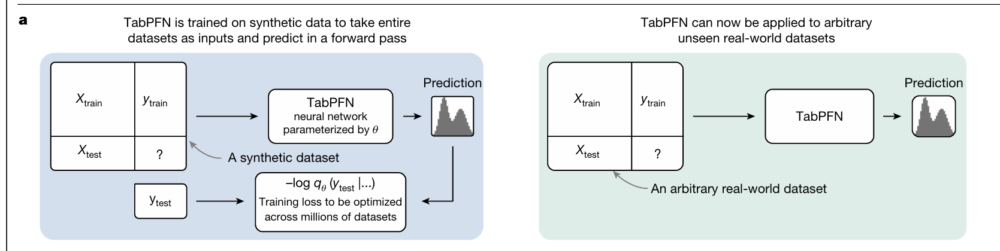
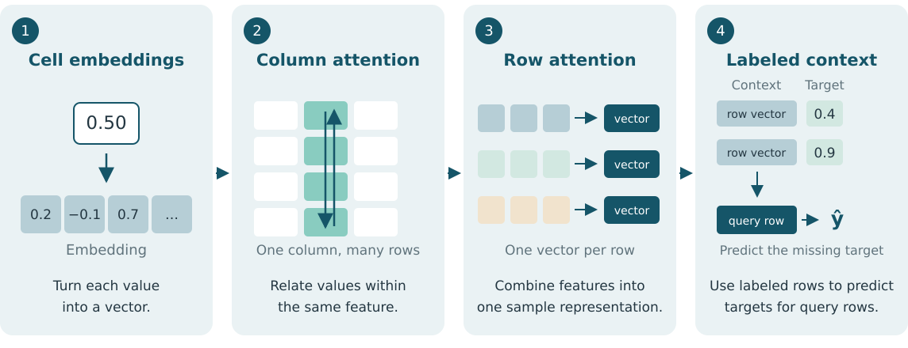
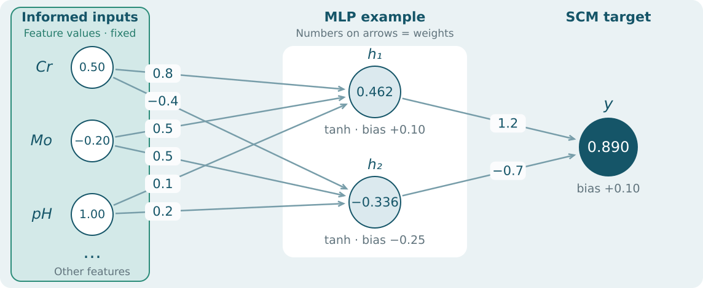
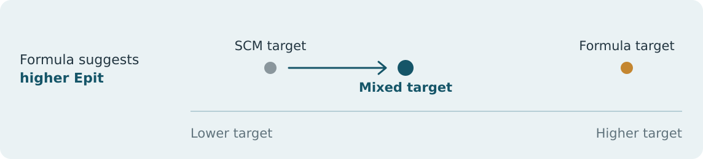
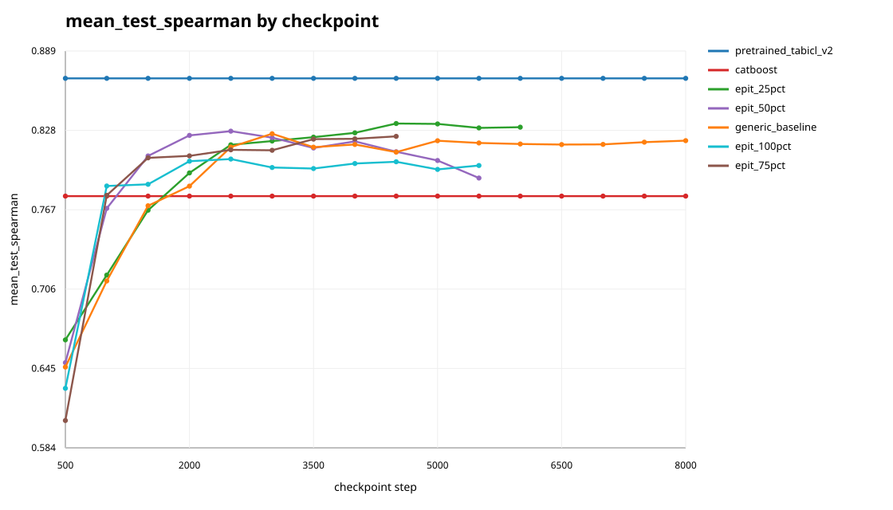
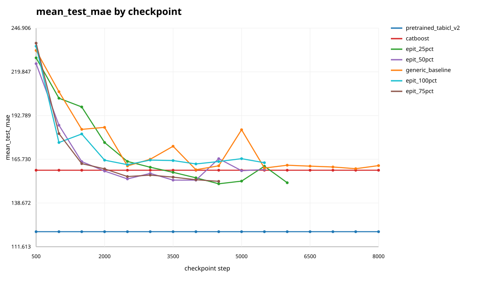
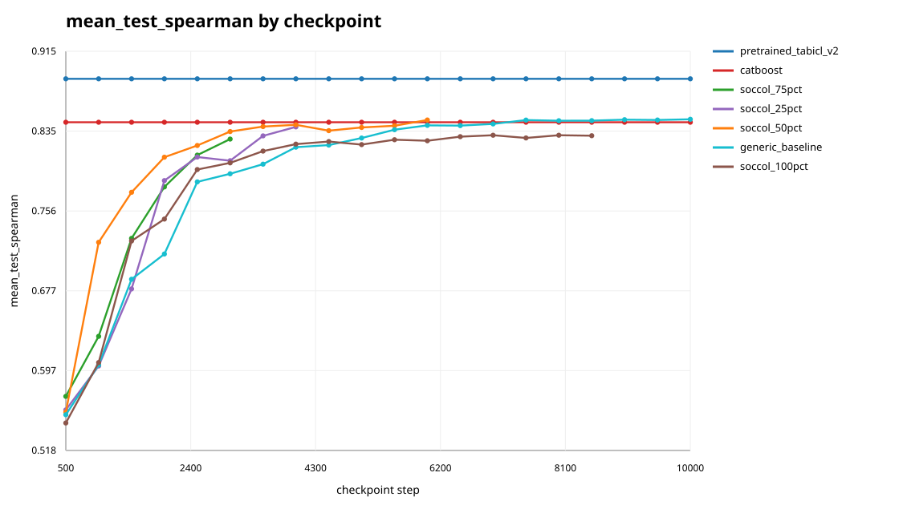
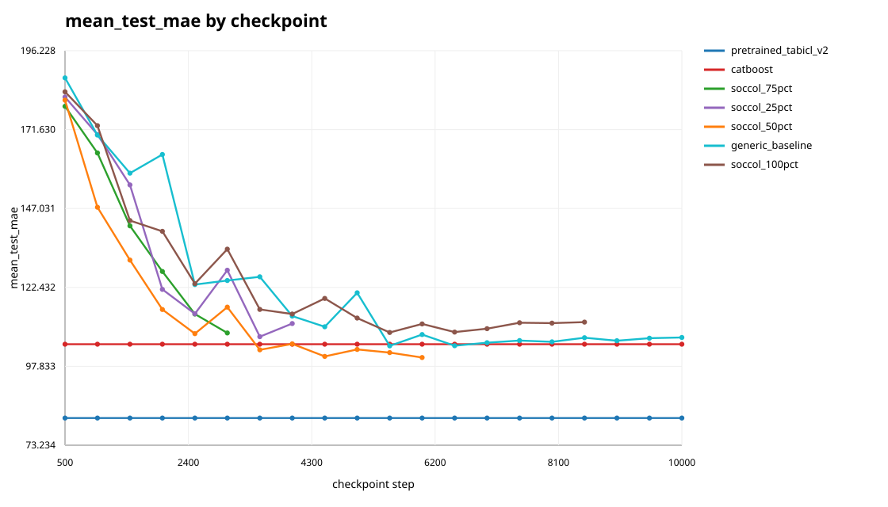

<!-- _class: cover -->
<!-- _paginate: false -->
<!-- _footer: '' -->

# Corrosion-informed learning with TabICL

Fabio Colantonio

---

<!-- _class: formulas -->

# How a conventional model learns

- Train a model directly on the available dataset.
- Compare predictions with real targets and adjust the model’s parameters.
- The result is a model fitted to that dataset.
- A different dataset or target usually requires new training.

$$
(x,y) \xrightarrow{\text{training}} \text{fitted model}
$$

$$
(\text{fitted model}, x^*) \longrightarrow y^*
$$

---

<!-- _class: formulas -->

# A model pretrained to learn from tables

- Tabular foundation models such as **TabPFN and TabICL are gaining popularity**, often outperforming conventional models on benchmark datasets.
- **Pretraining:** create synthetic tables with different relationships between features and target, and train TabICL on these tasks.

$$
\underbrace{D_1, D_2, \ldots, D_N}_{\text{synthetic tables}}
\xrightarrow{\text{pretraining}} \text{TabICL}
$$

- **Evaluation:** give TabICL labeled context and query features from a real dataset. Its parameters stay fixed.

$$
(\text{labeled context},\; \text{query features})
\xrightarrow{\text{pretrained TabICL}} \text{predicted targets}
$$

**The hope: synthetic tasks mimic the real evaluation task, so what the model learns transfers to real data.**

---

# Advantages

- **Quick predictions on a new dataset**
  - No dataset-specific training is needed.
  - Provide labeled context and query features; a forward pass produces predictions.

- **Broad application**
  - Use the same pretrained model across different tabular datasets and tasks.
  - Change the context data to apply it to a new task.

---

<!-- _class: scm-image -->

# Generating synthetic tables with SCM

---

<!-- _class: formulas -->

# Learning from context: An analogy to LLMs

- **LLM:** uses text context to predict the next tokens.
- **TabPFN / TabICL:** uses labeled rows as context to predict targets for query rows.
- In both cases, **context guides the predictions without changing the model’s weights**.

<!--
The image shows panel a of the supplied TabPFN figure, framed without changing
its pixels. Source: Hollmann et al. (2025), Nature, Figure 1a.
https://www.nature.com/articles/s41586-024-08328-6
The analogy concerns in-context prediction, not autoregressive token generation
by TabPFN or TabICL.
-->

---

# How TabICL uses attention

**Attention weights information from other values or examples.**

<!--
Schematic of this project's TabICL architecture, not TabPFN's alternating
feature/sample attention. Column embedding uses a shared set transformer;
row interaction pools through CLS tokens; dataset-level ICL adds encoded
context targets to row representations and predicts query targets.
Source: src/tabicl/model/{embedding,interaction,learning}.py.
Shown numbers and vector dimensions are illustrative. The column arrows
illustrate information exchange, not literal sequential computation. Context
arrow represents attention, not copying or averaging the two displayed labels.
-->

---

# Goal

Train **TabICL** on synthetic samples based on **real corrosion data**.

Keep the **TabICL architecture fixed**; change only the **prior**—how we generate synthetic training data.

## How:

- Start with a corrosion dataset containing alloy compositions, test conditions, and measured corrosion targets.
- Create new samples by sampling features from this dataset.
- Keep related features together: **composition, environment, test procedure, and material history**.
- Add small changes to the sampled compositions to create more variety.

<!-- Sampling uses development data only. -->

---

# Problem

- A measured target belongs to the original sample. If we change its features, we cannot simply copy its target.
- Copying whole samples limits us to the original dataset’s small set of examples.
- If those samples are also used as context at final evaluation, we repeat examples the model has already seen during training.

 

**We need new samples with targets that match their features.**

---

# Approaches

Start with features sampled from the corrosion dataset, with small changes to the composition. Generate a target for each new sample using:

1. A sampled **SCM mapping** applied to these features.

2. **Mathematical formulas** based on corrosion knowledge, applied to the same features.

---

# 1. Approach: SCM (structural causal model)

<!--
Simplified numerical MLP example, not a recorded model or its architecture.
h1 = tanh(0.8*Cr + 0.5*Mo + 0.1*pH + 0.1) = 0.462117
h2 = tanh(-0.4*Cr + 0.5*Mo + 0.2*pH - 0.25) = -0.336376
Output = 1.2*h1 - 0.7*h2 + 0.1 = 0.889604.
Inputs here are standardized feature values, not weight percentages.
Other feature contributions are set to zero in this illustrative calculation.
The actual generator uses sampled layer counts, weights, activations and noise.
Source: src/tabicl/prior/dataset.py, _generate_scm_target_from_physical_features.
-->

---

<!-- _class: formulas -->

# 2. Approach: Corrosion formulas

Take each sample's **features** and apply **corrosion formulas** to generate a new target.

**Example: PREN-N target formula:**

$$
y_{\mathrm{formula}}=
a\,\underbrace{P}_{\text{material resistance}}
-b\,\underbrace{E}_{\text{environment aggressiveness}}
-c\,\underbrace{I}_{\text{extra chloride penalty}}
$$

- **P:** calculated from alloy composition.
- **E:** calculated from temperature, chloride, and pH.
- **I:** calculated from material resistance and chloride together.

 

Fit <strong>a, b, c</strong> using the <strong>entire source dataset*</strong>.

*Currently fitted on development data; planned: the entire dataset.

---

<!-- _class: formulas -->

# 2. Approach: Material resistance P

Calculate **P** from the sample’s composition:

$$
P = z\!\left(\tanh\!\left(z\!\left(
\mathit{Cr} + 3.3(\mathit{Mo} + 0.5\,\mathit{W}) + 16\,\mathit{N}
\right)\right)\right)
$$

- *Cr*: chromium · *Mo*: molybdenum · *W*: tungsten · *N*: nitrogen.
- Use elemental concentrations in **weight percent**.
- **z** means standardization; **tanh** limits extreme values.

<!--
One complete target rule is shown, with its three transformed contributions
named by their physical meaning. The exact PREN-N mapping is:

M = z(Cr + 3.3*(Mo + 0.5*W) + 16*N)
C = z(log10(max(chloride, 1e-12)))
A = z(0.075*z(temperature) + 0.925*C + 0.115*z(abs(pH - 7.25)))
P = z(tanh(M))
E = z(sigmoid(A))
I = z(sigmoid(-M)*sigmoid(C))
y_formula = a*P - b*E - c*I

Here z denotes standardization using the corresponding context-fitted mean
and standard deviation; sigmoid(t) = 1/(1+exp(-t)), with numerical clipping
in the implementation. Elemental amounts are weight percentages.
The coefficients are nonnegative and sum to one. The v4 full-development
coefficient centers are a=0.54310, b=0.40942, c=0.04748.
The formula produces a synthetic target score, not a prediction in mV.
Domain knowledge defines the rule structure; development data fits its weights.

Source: ../../scripts/epit_pipeline/target_rules.py, PrenNLinearRule and CurrentPrenRule.
Artifact: ../../corrosion_datasets/analysis/epit_pipeline/target_rules_v4/pren_n_linear.json
The implementation standardizes the negative penalty terms before applying
their positive weights, which is equivalent to subtracting standardized
positive penalties as shown here. Final-test rows are excluded from fitting
and scoring. After fold scoring, generation coefficient centers are fitted
on all eligible development rows.
-->

---

<!-- _class: scores -->

# 2. Approach: Correlations

Spearman correlation between **formula-generated targets** and **real dataset targets**, averaged over five folds.

| Formula family | Spearman 5 folds |
| :--- | ---: |
| PREN-N | 0.506 |
| Cr–Mo/W–N synergy | 0.534 |
| Threshold / saturation | 0.510 |
| PREN-N with improved environment terms | 0.551 |
| Mo/W–N acidic-repassivation interaction | 0.549 |
| Mn–S penalty | 0.571 |
| Coupled breakdown | 0.534 |
| Fe/Ni-specific Cr threshold | 0.521 |
| Method-aware PREN-N | 0.591 |
| **Heat-treatment / cooling extension** | **0.648** |

<!--
Sources:
../../corrosion_datasets/analysis/epit_pipeline/formula_extensions_v2/frozen_development_folds/summary.csv
../../corrosion_datasets/analysis/epit_pipeline/formula_extensions_v2/source_publication_folds/summary.csv
../../corrosion_datasets/analysis/epit_pipeline/formula_extensions_v2/key_comparison.csv
../../src/tabicl/prior/assets/epit_target_v5.json
../../scripts/epit_pipeline/README.md, EPIT final-training target v5.

Values are mean_spearman, rounded to three decimals, for the same 452 eligible
Fe/Ni development rows. The nine existing rules retain their v4 development
scores. The new rule is extend_heat_categories: method-aware PREN-N with
heat-treatment type and cooling-category corrections.
Its development score is 0.648288, compared with 0.590773 for method-aware
PREN-N; publication-held-out scores are 0.349157 and 0.377865, respectively.
The higher development-fold score did not transfer to held-out publications.
Candidate selection used development results, so these individual-rule scores
are exploratory and subject to selection optimism. This table reports formula
evaluation, not frozen final-model evaluation or an Optuna-tuned v5 result.
The final-test partition remains excluded from both comparisons.
-->

---

# Mix SCM and formula targets

- Mix SCM targets and formula targets into a **single target used for training**.
- Standardize both target distributions to the same scale before mixing.
- Sample a formula weight **α** for each synthetic table.

$$
y_{\mathrm{mixed}}=(1-\alpha)\,z(y_{\mathrm{SCM}})+\alpha\,z(y_{\mathrm{formula}})
$$

α = 0: SCM only · α = 1: formula only. The informed/generic dataset ratio is a separate setting.

<!--
z denotes standardization. Alpha denotes the formula weight for a table.
For the configured EPIT recipe, alpha is uniform on [0, 0.5731951724210421],
with fixed mean 0.28659758621052106.
-->

---

<!-- _class: workflow -->

# The idea: Nudge the SCM target

The **SCM mapping** gives a target. In this example, the **corrosion formula** nudges it toward higher Epit.

The mixing weight **α** controls how far the target moves toward the formula target.

<!--
Conceptual illustration of interpolation between standardized SCM and formula
scores, before final standardization. Positions are illustrative, not measured
Epit values or the configured mean mixing weight. The SCM target comes from a
sampled feature-to-target mapping, not independent random labels. The formula
supplies a corrosion-informed direction; it does not guarantee the true target.
-->

---

<!-- _class: workflow -->

# Workflow: Dataset and formulas

- Choose a dataset for **pitting potential (Epit)**.
- Harmonize feature names and units across datasets.
- Define target formulas using corrosion knowledge.
- Fit the **formula coefficients** to the real dataset targets using the **entire source dataset***.
- For each synthetic table, **sample one formula rule** with probability proportional to its **correlation score**. Higher-scoring rules are sampled more often.

*Currently fitted on development data; planned: the entire dataset.

<!--
The full-dataset fit is planned, not implemented. The existing five-fold
correlation table reports earlier development-only formula evaluations.
The saved EPIT split uses 608 development rows and 152 final-test rows.
Source: ../../scripts/epit_pipeline/README.md.
-->

---

# Workflow: Fixed hyperparameters

These settings apply to the **informed generator**. The **generic generator stays unchanged**.

- **MLP / tree mix:** **70% / 30%** of informed tables.
- **Target mix:** mean formula weight **0.2866**; sample α uniformly from **0 to 0.5732** per table.
- **Perturbation strength: 0.30** for multiplicative composition noise; normalize to **100 wt.%**.

<!--
Settings verified against scripts/epit_pipeline/finetune.py and the v5 recipe
in scripts/epit_pipeline/README.md. Perturbation multiplies nonzero amounts
by exp(Normal(0, 0.30)), then closes the composition to 100 wt.%.
The mixing distribution settings are fixed; alpha varies by table.
-->

---

<!-- _class: workflow -->

# Workflow: Training and evaluation

- Fit formula coefficients on the **entire dataset***.
- Train for **10,000 steps** at each informed-data ratio:
  - **25% · 50% · 75% · 100%** informed; the remainder is generic.
- Evaluate using **5-fold cross-validation** on the original dataset.
  - Use four folds as **labeled context** and predict targets for the remaining fold.
  - Repeat for all five folds and average the scores.
- Use the **same five folds** for every model comparison.

*Currently fitted on development data; planned: the entire dataset.

<!--
This describes the requested planned evaluation workflow, not the current
frozen outer final-test evaluation implementation. Full-dataset coefficient
fitting uses labels from all five folds; these CV scores therefore do not
measure performance on targets excluded from prior fitting.
Training budgets are steps, not numbers of checkpoints.
-->

---

<!-- _class: workflow -->

# Next step: Combined model

- Train one model using **two Epit priors** and the **generic prior**.
- Sample from these three sources according to their mixing ratios.
- Use each informed prior’s fixed generation settings.
- Evaluate on a **third Epit dataset**, unused for coefficient fitting and training.

---

# Workflow: Example mixing ratios

Example configurations:

- Prior 1: **50% informed** data.
- Prior 2: **100% informed** data.

Give the two configurations equal weight in the combined model:

| Combined training source | Ratio |
| :--- | ---: |
| Informed prior 1 | 0.25 |
| Informed prior 2 | 0.50 |
| Generic prior | 0.25 |

<!-- Equal weighting: 0.5 × 0.5 = 0.25; 0.5 × 1.0 = 0.50; generic remainder = 0.25. -->

---

# Recap: Informed generator

Corrosion knowledge is embedded into the prior by:

1. **Mimicking the feature distributions of real Epit data.**

2. **Generating targets that reflect how those features affect Epit.**

---

# Future directions

- Extend the approach to **other corrosion tasks**.
- Explore shared **learning rates, architectures, and SCM settings**.
- Represent missing features explicitly with a **missingness vector or embedding**.

---

# Results: Comparison models

- **Generic — retrained baseline**
  - TabICL **v1 data generator** with the **v2 architecture**.
  - Retrained using default settings and generic synthetic data.

- **Pretrained — released TabICL model**
  - TabICL **v2 data generator** and **v2 architecture**.
  - Uses the pretrained checkpoint.

- **CatBoost — tree-based baseline**
  - Gradient-boosted decision trees fitted on the real labeled data.

 

**Goal: outperform the generic baseline; ideally, outperform all comparison models.**

---

# Results: Datasets

All three datasets are used to predict **pitting potential (Epit)**.

- **Epit — Electrochemical Metrics for Corrosion Resistant Alloys**
  - The pitting-potential subset of a broader corrosion database.
  - Covers alloy composition, environment, and material history.

- **Soccol — Pitting Potential Database, compiled by Dimitri Soccol**
  - Focuses on pitting potential, with detailed composition, surface preparation, and test conditions.

- **MPEA — Multi-principal element alloys**
  - Alloys with several main elements, rather than one dominant base metal.
  - Covers composition, phases, processing, and test environment.

<!--
Sources: corrosion_datasets/datasets/electrochemical_metrics_alloys/{README.md,schema_summary.md};
soccol_pitting_potential/{README.md,schema_summary.md,literature.md};
mpea_corrosion/{README.md,schema_summary.md}.
Dataset names are presentation labels. Epit denotes the selected pitting subset;
the MPEA source also contains corrosion potential and corrosion current targets.
-->

---

<!-- _class: result-plot -->

# Results: Epit — Spearman

<!-- Mean over five CV folds; higher is better. Source: ../targetv5_four_ratios_through_8000_cv5/plots/trend_mean_test_spearman.svg -->

---

<!-- _class: result-plot -->

# Results: Epit — MAE

<!-- Mean over five CV folds; lower is better. Source: ../targetv5_four_ratios_through_8000_cv5/plots/trend_mean_test_mae.svg -->

---

<!-- _class: result-plot -->

# Results: Soccol — Spearman

<!-- Mean over five CV folds; higher is better. Source: ../soccol_four_ratios_cv5_updated/plots/trend_mean_test_spearman.svg -->

---

<!-- _class: result-plot -->

# Results: Soccol — MAE

<!-- Mean over five CV folds; lower is better. Source: ../soccol_four_ratios_cv5_updated/plots/trend_mean_test_mae.svg -->
